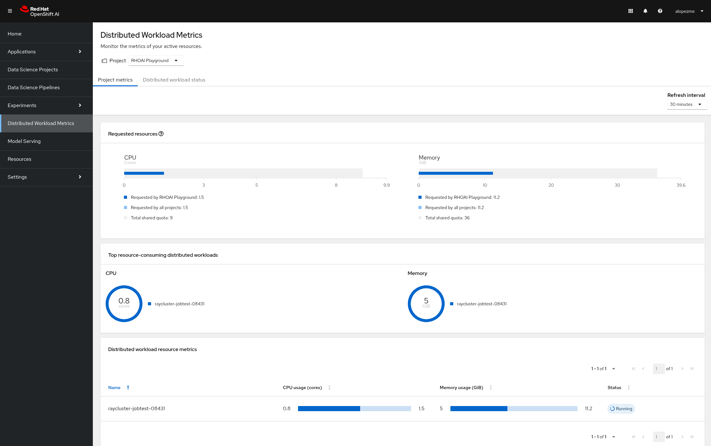
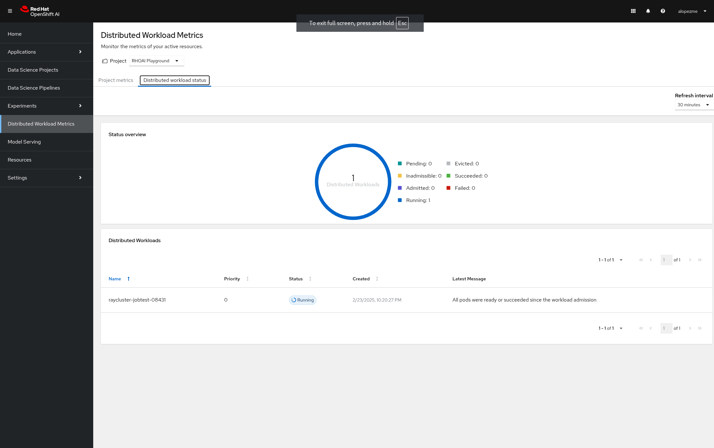
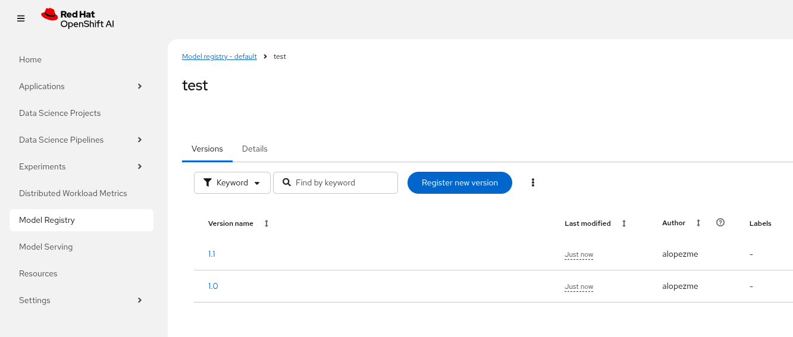

# Red Hat OpenShift AI

**Álvaro López Medina** — [alopezme@redhat.com](mailto:alopezme@redhat.com)  
*v1.0, 2024-03*

Red Hat OpenShift AI (RHOAI) is OpenShift’s enterprise AI/MLOps platform for the full model lifecycle—train, serve, monitor, and govern. This repo is my playground to deploy and try its main features.

## Table of contents

1. [Red Hat OpenShift AI](#red-hat-openshift-ai)
   1. [Table of contents](#table-of-contents)
   2. [Red Hat Training](#red-hat-training)
   3. [RHOAI Architecture](#rhoai-architecture)
      1. [DataScienceCluster components](#datasciencecluster-components)
   4. [Installation](#installation)
      1. [Installation on non-4.22 OCP](#installation-on-non-422-ocp)
      2. [Let's install!!](#lets-install)
   5. [Things you should know!](#things-you-should-know)
      1. [NVIDIA GPU nodes](#nvidia-gpu-nodes)
      2. [NVIDIA GPU partitioning](#nvidia-gpu-partitioning)
      3. [Pipeline S3 storage](#pipeline-s3-storage)
      4. [Managing distributed workloads](#managing-distributed-workloads)
      5. [Kueue queues (reserved-spot)](#kueue-queues-reserved-spot)
      6. [Model Registry](#model-registry)
   6. [Monitoring, Safety and Evaluation](#monitoring-safety-and-evaluation)
   7. [Deploying models (inference serving)](#deploying-models-inference-serving)
   8. [Extra Components](#extra-components)
      1. [Silo](#silo)
      2. [Open WebUI](#open-webui)
      3. [Milvus](#milvus)
      4. [Langfuse](#langfuse)
   9. [Extra documentation](#extra-documentation)
      1. [Useful links](#useful-links)
      2. [Study sources](#study-sources)
      3. [Nice demos and projects to take a look](#nice-demos-and-projects-to-take-a-look)

## Red Hat Training

RHOAI evolves quickly, so **this repo may become outdated**. For the latest product behavior, use the [official documentation](https://docs.redhat.com/en/documentation/red_hat_openshift_ai_self-managed/3.4).

Hands-on learning is consolidated in one course: **AI267** — *Developing and Deploying AI/ML Applications on Red Hat OpenShift AI* (projects, notebooks, training, serving, pipelines, and administration). See [Red Hat Training](https://role.rhu.redhat.com/rol-rhu/app) for schedules and labs.

## RHOAI Architecture

The following diagram depicts the general architecture of a RHOAI deployment, including the most important components:


### DataScienceCluster components

This repo configures `DataScienceCluster` in `rhoai-installation-chart/templates/02-rhoai-configuration/DataScienceCluster.yaml`:

| Component | Purpose | Default in this repo |
|-----------|---------|----------------------|
| dashboard | RHOAI dashboard | Managed |
| workbenches | Notebook/IDE workbenches (`rhods-notebooks`) | Managed |
| aipipelines | Kubeflow Pipelines + embedded Argo Workflows | Managed |
| kserve | Model serving (KServe RawDeployment, NIM) | Managed |
| aigateway | AI Gateway with the Models-as-a-Service (MaaS) controller. It replaces the deprecated `kserve.modelsAsService` | Managed if `modelsAsService.enabled` |
| ray | Distributed Ray workloads | Managed |
| trainingoperator | Distributed training (PyTorch, TensorFlow, MPI) | Managed |
| kueue | Queues for distributed workloads (operator installed separately) | Unmanaged if `distributedWorkloads.enabled` |
| modelregistry | Central model catalog (`rhoai-model-registries`) | Managed if `modelRegistry.enabled` |
| trustyai | Bias, drift, guardrails, LM-Eval | Managed if `trustyai.enabled` |
| feastoperator | Feast feature store | Managed if `featureStore.enabled` |
| mlflowoperator | MLflow tracking | Managed if `mlflow.enabled` |
| ogx | OGX (formerly Llama Stack) RAG/agent APIs. `llamastackoperator` is deprecated and kept `Removed` | Managed if `ogx.enabled`; the Gen AI Studio playground needs it |
| mcplifecycleoperator | Deploys the MCP servers of the dashboard's MCP Catalog and Registry | Managed if `agentic.enabled` |

### Chart layout

The templates of `rhoai-installation-chart` are numbered in the order that makes sense when you read them: first the operator and its configuration, then the infrastructure it needs, the platform services, the model serving stacks and, last, the apps and the demo content. Each service keeps its own database in a `db` folder.

| Folder | What it deploys |
|---|---|
| `01-rhoai-operator` | OpenShift AI operator (namespace, OperatorGroup, Subscription) |
| `02-rhoai-configuration` | DataScienceCluster, dashboard configuration, notebook culler |
| `03-metalLB` | IP pool for `LoadBalancer` services on bare metal |
| `04-kueue` | Queues, flavors and priorities (reserved-spot) |
| `05-hardware-profiles` | Hardware profiles that point to the queues |
| `06-dra` | Dynamic Resource Allocation: `ResourceClaimTemplate`s as GPU t-shirt sizes (`gpu-s-x1`, `gpu-m-x1`, `gpu-l-x1`, `gpu-xl-x1`, `gpu-xl-x2`) |
| `07-model-registry` | Model registry |
| `08-feature-store` | Feast feature stores |
| `09-mlflow` | MLflow tracking server |
| `10-llm-d` | Direct llm-d gateway and dashboards |
| `11-maas` | Models-as-a-Service: `1-db`, `2-gateway`, `3-observability`, `4-grafana`, `5-demo` (demo content: the simulator model with its subscriptions, the only model of this repo, the access to the models of rhoai-serving is generated there), `6-keycloak` (only the namespace of the Keycloak tenant, with its LocalQueues and DRA claim templates) |
| `12-evalhub` | EvalHub: `1-db`, `2-evalhub` |
| `13-training` | `rhoai-training` project for training jobs, enabled with `training.enabled` (Kubeflow Trainer v2): Kueue namespace with its LocalQueues, no jobs. See [docs/training-options.md](docs/training-options.md) |
| `14-nim` | `nim.enabled` (default `true`): the models project of the NVIDIA NIM platform (`nim.namespace`, `rhoai-nim-models`, adopted if it already exists), with its Kueue LocalQueues and DRA claim templates. It also sets `kserve.nim` in the `DataScienceCluster` and shows the NIM option in the dashboard. The `Account` CR and the NGC secrets are in [rhoai-nim](https://github.com/alvarolop/rhoai-nim) |

## Installation

RHOAI needs GPU infrastructure, platform operators, object storage, and a `DataScienceCluster` configuration. Use `auto-install.sh` to apply the Argo CD applications in order.

**Tested on:** OpenShift Container Platform **4.22** (latest). Some components are tied to the OCP version, see [Installation on non-4.22 OCP](#installation-on-non-422-ocp) for older releases.

**Prerequisites:** `oc` login, OpenShift GitOps (Argo CD) on the cluster, and enough memory on untainted workers (checked against `REQUIRED_MEMORY_Gi`, default 70 Gi).

Edit the toggles at the top of `auto-install.sh` to skip steps you do not need. By default the script:

1. *(Optional)* Provisions AWS GPU worker MachineSets when `GPU_NODE_COUNT` > 0 (`AWS_GPU_INSTANCE`, default `g6.2xlarge`; nodes are GPU-tainted).
2. Deploys dependencies via `application-rhoai-dependencies.yaml` (NVIDIA GPU stack, Kueue, Leader Worker Set, JobSet, RHCL, KEDA) and enables the NVIDIA GPU console plugin.
3. *(Optional)* Installs OpenShift Pipelines (`INSTALL_PIPELINES`), the Cost Management Metrics Operator (`INSTALL_COST_MANAGEMENT`, off by default: it uploads usage to [console.redhat.com](https://console.redhat.com) Cost Management, which needs internet and a Red Hat account, and creates an OpenShift integration named after the cluster ID; see `addons/ocp-cost-management`) and S3 storage: S4 (`INSTALL_S4`, default) and Silo (`INSTALL_SILO`, off by default). Buckets are created in S4, including a playground bucket when `CREATE_RHOAI_ENV=true`.
4. *(Optional)* Installs ODF in MCG mode (`INSTALL_ODF`, off by default) or OpenShift user-workload monitoring (`INSTALL_MONITORING`, on by default, see [Metrics and user-workload monitoring](#metrics-and-user-workload-monitoring)).
5. Waits for GPU nodes when `GPU_NODE_COUNT` > 0, then installs RHOAI via `application-rhoai-installation.yaml` (operator + Helm chart defaults: model registry, distributed workloads, TrustyAI, Feast, MLflow, OGX, llm-d, and related settings).
6. *(Optional)* Installs Keycloak with a MaaS realm (`INSTALL_KEYCLOAK`, via `application-keycloak.yaml` from [keycloak-playground](https://github.com/alvarolop/keycloak-playground)) and a second MaaS tenant, `maas-keycloak`, whose users sign in with Keycloak tokens instead of OpenShift identities. The tenant has its own Gateway, its own Application (`application-maas-keycloak.yaml`, chart `maas-keycloak-chart`) and its own namespace (`ai-tenant-maas-keycloak`), so it does not change the default tenant (`models-as-a-service`) and a failure in it cannot block `rhoai-installation`. Technology Preview in RHOAI 3.5.
7. *(Optional)* Deploys the RHOAI Playground project (`CREATE_RHOAI_ENV`, with its pipelines storage pointing to S4) and Langfuse when `INSTALL_LANGFUSE` is enabled.

If you plan to use GPU nodes on AWS, the script also prints the Service Quotas commands to request and check the Running On-Demand G and VT instances limit.

### Installation on non-4.22 OCP

Some of the components deployed in this repo are bound to an specific version of OpenShift. If you want to deploy RHOAI on an older version (For example 4.21), you have to make the following modifications:

- Change the channel of ODF:
  - In `./addons/ocp-odf/odf-operator/sub-odf-operator.yaml`, the value of `.spec.channel` field should be `stable-4.21`.

### Let's install!!

> [!TIP]
> The script contains many tasks divided in clear blocks with comments. Use the Environment Variables or add comments to disable those that you are not interested in.

In order to automate it all, it relays on OpenShift GitOps (ArgoCD), so you will to have it installed before executing the following script. Check out my automated installation on [alvarolop/ocp-gitops-playground](https://github.com/alvarolop/ocp-gitops-playground) GitHub repository.

Now, log in to the cluster and just execute the script:

```bash
./auto-install.sh
```

## Things you should know!

### NVIDIA GPU nodes

Most of the activities related to RHOAI will require GPU Acceleration. For that purpose, we add NVIDIA GPU nodes during the installation process. In this chapter, I collect some information that might be useful for you.

In this automation, we are currently using the AWS `g6.2xlarge` instance (see `AWS_GPU_INSTANCE` in `auto-install.sh`). According to the documentation:

> Amazon EC2 G6 instances are designed to accelerate graphics-intensive applications and machine learning inference. They can also be used to train simple to moderately complex machine learning models.

#### How to know that a node has NVIDIA GPUs using NodeFeatureDiscovery?

The output of the following command will only be visible when you have applied the ArgoCD `Application` and the Node Feature Discovery operator has scanned the OpenShift nodes:

```bash
oc describe node | egrep 'Roles|pci'
Roles:              control-plane,master
Roles:              worker
                    feature.node.kubernetes.io/pci-1d0f.present=true
Roles:              gpu-worker,worker
                    feature.node.kubernetes.io/pci-10de.present=true
                    feature.node.kubernetes.io/pci-1d0f.present=true
Roles:              control-plane,master
Roles:              control-plane,master
```

`pci-10de` is the PCI vendor ID that is assigned to NVIDIA.

The NVIDIA GPU Operator automates the management of all NVIDIA software components needed to provision GPU. These components include the NVIDIA drivers (to enable CUDA), Kubernetes device plugin for GPUs, the NVIDIA Container Runtime, automatic node labelling, DCGM based monitoring and others.

After configuring the Node Feature Discovery Operator and the NVidia GPU Operator using GitOps, you need to confirm that the Nvidia operator is correctly retrieving the GPU information. You can use the following command to confirm that OpenShift is correctly configured:

```bash
# Simple command - gets first pod (may not match node order)
oc exec -it -n nvidia-gpu-operator $(oc get pod -o wide -l openshift.driver-toolkit=true -o jsonpath="{.items[0].metadata.name}" -n nvidia-gpu-operator) -- nvidia-smi

# More precise - filter by node number (0, 1, 2, etc.)
# For node 0:
oc exec -it -n nvidia-gpu-operator $(oc get pod -l openshift.driver-toolkit=true -o name -n nvidia-gpu-operator | grep '\-0$' | head -1 | cut -d'/' -f2) -- nvidia-smi
# For node 1:
oc exec -it -n nvidia-gpu-operator $(oc get pod -l openshift.driver-toolkit=true -o name -n nvidia-gpu-operator | grep '\-1$' | head -1 | cut -d'/' -f2) -- nvidia-smi
# For node 2:
oc exec -it -n nvidia-gpu-operator $(oc get pod -l openshift.driver-toolkit=true -o name -n nvidia-gpu-operator | grep '\-2$' | head -1 | cut -d'/' -f2) -- nvidia-smi
```

The output should look like this:

```bash
Wed Apr 29 22:08:43 2026
+-----------------------------------------------------------------------------------------+
| NVIDIA-SMI 580.126.20             Driver Version: 580.126.20     CUDA Version: 13.0     |
+-----------------------------------------+------------------------+----------------------+
| GPU  Name                 Persistence-M | Bus-Id          Disp.A | Volatile Uncorr. ECC |
| Fan  Temp   Perf          Pwr:Usage/Cap |           Memory-Usage | GPU-Util  Compute M. |
|                                         |                        |               MIG M. |
|=========================================+========================+======================|
|   0  NVIDIA L4                      On  |   00000000:35:00.0 Off |                    0 |
| N/A   56C    P0             37W /   72W |   20002MiB /  23034MiB |      0%      Default |
|                                         |                        |                  N/A |
+-----------------------------------------+------------------------+----------------------+

+-----------------------------------------------------------------------------------------+
| Processes:                                                                              |
|  GPU   GI   CI              PID   Type   Process name                        GPU Memory |
|        ID   ID                                                               Usage      |
|=========================================================================================|
|    0   N/A  N/A           64510      C   VLLM::EngineCore                      19994MiB |
+-----------------------------------------------------------------------------------------+
```

If, for some race condition, RHOAI is not detecting that GPU worker, you might need to force it to recalculate. You can do so easily with the following command:

```bash
oc delete cm migration-gpu-status -n redhat-ods-applications; sleep 3; oc delete pods -l app=rhods-dashboard -n redhat-ods-applications
```

Wait for a few seconds until the dashboard pods start again and you will see in the RHOAI web console that now the `NVidia GPU` Accelerator Profile is listed.

### GPU flavors: device plugin or DRA

`rhoai-dependencies/operator-nvidia-gpu` has two flavors, and `variants/*/kustomization.yaml` picks one (a cluster cannot have both):

| Folder | What it creates | How pods ask for a GPU |
|---|---|---|
| `dra/` | `GPUCluster` + `NVIDIADriver` (GPU Operator 26.7+, Dynamic Resource Allocation) | `resourceClaims` with a `ResourceClaimTemplate` (`templates/06-dra`), selected by CEL attributes |
| `device-plugin/` (default) | `ClusterPolicy` with the device plugin and the MIG manager | `resources.limits: nvidia.com/gpu` |

In the DRA flavor there is no device plugin or MIG manager, so the GPU hardware profiles (`nvidia.com/gpu` identifiers) and the Kueue GPU quota do not apply to DRA claims. `device-plugin/` is the default and the chart has `dra.enabled: false`; set it to `true` together with `dra/`. You cannot migrate in place: delete the `ClusterPolicy` (or the `GPUCluster`) first. The sizes (one file each in `templates/06-dra`) are one exact request with a memory selector each, because Kueue does not support `firstAvailable`, so there is no MIG fallback; the `firstAvailable` version with the MIG alternatives is kept commented in each file (see `docs/gpu-dra.md`).

### NVIDIA GPU partitioning

This repo does not enable time-slicing or MIG by default; options depend on your GPU model and what the NVIDIA GPU Operator supports. Before changing `rhoai-dependencies/operator-nvidia-gpu`, read:

- [GPU partitioning guide](https://github.com/rh-aiservices-bu/gpu-partitioning-guide) (Red Hat AI Services BU)
- [Sharing is caring: How to make the most of your GPUs (part 1 — time-slicing)](https://www.redhat.com/en/blog/sharing-caring-how-make-most-your-gpus-part-1-time-slicing)
- [Sharing is caring: How to make the most of your GPUs (part 2 — Multi-instance GPU)](https://www.redhat.com/en/blog/sharing-caring-how-make-most-your-gpus-part-2-multi-instance-gpu)

### Pipeline S3 storage

Pipelines need S3-compatible storage for artifacts. With the default `auto-install.sh` settings (`INSTALL_S4=true`, `CREATE_RHOAI_ENV=true`), S4 is deployed and `create-s4-s3-bucket.sh` creates the bucket and dashboard connection secret—no manual step. The playground DSPA is pointed at S4 (`s4.s4.svc.cluster.local:7480`) by `application-rhoai-playground-env.yaml`.

For AWS S3, ODF/NooBaa, or a custom endpoint, use the scripts and templates under `addons/s3-bucket/` (see `aws-env-vars.example` for AWS).

### Managing distributed workloads

You can use the distributed workloads feature to queue, scale, and manage the resources required to run data science workloads across multiple nodes in an OpenShift cluster simultaneously. These three components need to be enabled on the RHOAI installation configuration:

- **CodeFlare**: Secures deployed Ray clusters and grants access to their URLs.
- **KubeRay**: Manages remote Ray clusters on OpenShift for running distributed compute workloads.
- **Kueue**: Manages quotas and how distributed workloads consume them, and manages the queueing of distributed workloads with respect to quotas.

If you want to try this feature, I recommend you to follow the RH documentation, which points to the following [Guided Demos](https://github.com/project-codeflare/codeflare-sdk/tree/main/demo-notebooks/guided-demos).

- Documentation: [Installation guide](https://docs.redhat.com/en/documentation/red_hat_openshift_ai_self-managed/3.4/html-single/installing_and_uninstalling_openshift_ai_self-managed/index#updating-installation-status-of-openshift-ai-components-using-web-console_component-install).
- Documentation: [Configuration guide](https://docs.redhat.com/en/documentation/red_hat_openshift_ai_self-managed/3.4/html/managing_openshift_ai/managing-distributed-workloads_managing-rhoai).
- Documentation: [Usage guide](https://docs.redhat.com/en/documentation/red_hat_openshift_ai_self-managed/3.4/html/working_with_distributed_workloads).

After everything is configured, you can use the Model Tunning example from the Helm chart to see some stats:

```bash
helm template ./rhoai-environment-chart \
    -s templates/modelTunning/cm-training-config.yaml \
    -s templates/modelTunning/cm-twitter-complaints.yaml \
    -s templates/modelTunning/pvc-trained-model.yaml \
    -s templates/modelTunning/pytorchjob-demo.yaml \
    --set modelTunning.enabled=true | oc apply -f -
```

You can also see some stats from the RHOAI dasboard:





### Kueue queues (reserved-spot)

GPUs are shared with the *reserved-spot* pattern from [kueue-reserved-spot](https://github.com/MarkusGersdorf/kueue-reserved-spot): model servers own the GPU quota and batch work borrows whatever is idle and is evicted and requeued (never failed) when a model needs it back. Queues live in `rhoai-installation-chart/templates/04-kueue/` (Kueue `v1beta2`) and are selected through the HardwareProfile (`spec.scheduling.kueue`):

| ClusterQueue | Flavor | Role | HardwareProfile → LocalQueue |
|---|---|---|---|
| `default-cq` | `cpu-flavor` | General queue and workbenches. Non-preemptive, as RHOAI requires for workbenches | `cpu-profile` → `default` |
| `serving-cq` | `gpu-flavor` | Owns the whole GPU pool and reclaims it from batch (`reclaimWithinCohort: Any`) | `gpu-profile` → `serving-lq` |
| `batch-cq` | `gpu-flavor` | Owns nothing, borrows idle GPUs (`borrowingLimit`) | `gpu-batch-profile` → `batch-lq` |

`serving-cq` and `batch-cq` share the cohort `gpu-cluster`. Four `WorkloadPriorityClass` objects (`model-critical`, `model-standard`, `batch-interactive`, `batch-nightly`) order work inside each queue.

- **Quotas** are written in each ClusterQueue file of `templates/04-kueue` (`ClusterQueue-default-cq.yaml`, `ClusterQueue-serving-cq.yaml`, `ClusterQueue-batch-cq.yaml`). They fit one AWS `g6.2xlarge` node (1x NVIDIA L4, no MIG). The H100/MIG configuration is kept commented at the end of the same files, see [gpu-mig.md](docs/gpu-mig.md).
- **LocalQueues:** HardwareProfiles are global, so the LocalQueue they name has to exist in every namespace that deploys with them, and RHOAI only creates `default` (pointing to `default-cq`) in new dashboard projects. This chart creates `default`, `serving-lq` and `batch-lq` in the namespaces listed in `distributedWorkloads.localQueueNamespaces` (`models-as-a-service` by default). For any other namespace, its owner (for example the repo that deploys the models) must create the namespace with the label below and the same three LocalQueues:

  ```bash
  oc apply -n <project> -f - <<EOF
  apiVersion: kueue.x-k8s.io/v1beta2
  kind: LocalQueue
  metadata: {name: serving-lq}
  spec: {clusterQueue: serving-cq}
  ---
  apiVersion: kueue.x-k8s.io/v1beta2
  kind: LocalQueue
  metadata: {name: batch-lq}
  spec: {clusterQueue: batch-cq}
  EOF
  ```

  Add such a namespace to the list only if it already exists with the label, otherwise the sync of the chart fails.
- **Namespaces** must carry `kueue.openshift.io/managed=true` or Kueue ignores them. The dashboard adds it to new projects when Kueue is enabled; projects created with GitOps need to set it (this chart does for `models-as-a-service` and `rhoai-training`).
- **Priority:** in RHOAI 3.5 the HardwareProfile `priorityClass` was not applied to an `LLMInferenceService` (only the queue label was, so its Workload got priority 0). Set the label `kueue.x-k8s.io/priority-class: model-critical` on the workload itself.
- **Kueue CR:** with `kueue: Unmanaged` the RHOAI operator creates the `Kueue` CR itself, including the frameworks RHOAI needs (Ray, PyTorchJob, TrainJob, ...). It is not managed here. Gang scheduling uses the Red Hat build of Kueue 1.5 default (`ByWorkloadDefaults`, 30 minute readiness timeout).
- Keep batch jobs small and restartable: Kueue preempts a whole Workload, and an evicted Job restarts from the beginning unless it checkpoints.

### Model Registry

OpenShift AI now includes the possibility to deploy a model registry to store community and customized AI models. The chart creates the registry `local` in `rhoai-model-registries`, with the PostgreSQL that the operator deploys for it (`postgres.generateDeployment`, the dashboard's *Default database*). It is meant for tests and demos, not for production: edit `templates/07-model-registry/ModelRegistry-local.yaml` to point it to an external PostgreSQL or MySQL. The registry stores the metadata of your models. Once deployed, your training pipelines can add an extra step putting model metadata to the registry.

Using RHOAI Model Registry you have a centralized source of models as well as a simple way to deploy prepared models:



Here you can find examples of REST requests to query model metadata:

```bash
MODEL_REGISTRY_NAME=local
MODEL_REGISTRY_HOST=$(oc get route ${MODEL_REGISTRY_NAME}-https -n rhoai-model-registries -o go-template='https://{{.spec.host}}')
TOKEN=$(oc whoami -t)

# List models
curl -s "$MODEL_REGISTRY_HOST/api/model_registry/v1alpha3/registered_models?pageSize=100&orderBy=ID&sortOrder=DESC" \
  -H "accept: application/json" \
  -H "Authorization: Bearer ${TOKEN}" | jq .

# List all model versions 
MODEL_NAME="test"
MODEL_ID="4"

curl -s "$MODEL_REGISTRY_HOST/api/model_registry/v1alpha3/registered_model?name=${MODEL_NAME}&externalId=${MODEL_ID}" \
  -H "accept: application/json" \
  -H "Authorization: Bearer ${TOKEN}" | jq .

curl -s "$MODEL_REGISTRY_HOST/api/model_registry/v1alpha3/registered_models/${MODEL_ID}/versions?name=${MODEL_NAME}&pageSize=100&orderBy=ID&sortOrder=DESC" \
  -H "accept: application/json" \
  -H "Authorization: Bearer ${TOKEN}" | jq .
```

If you want to try this feature, I recommend you to follow the RH documentation:

- Documentation step 1: [Enabling the model registry component](https://docs.redhat.com/en/documentation/red_hat_openshift_ai_self-managed/3.5/html/managing_model_registries/enabling-the-model-registry-component_managing-model-registries).
- Documentation step 2: [Managing model registries](https://docs.redhat.com/en/documentation/red_hat_openshift_ai_self-managed/3.5/html/managing_model_registries).
- Documentation step 3: [Working with model registries](https://docs.redhat.com/en/documentation/red_hat_openshift_ai_self-managed/3.5/html/working_with_model_registries).

### Feature Store

`featureStore.enabled` turns on the Feast operator and creates a `FeatureStore` for each enabled entry of `featureStore.examples` in `rhoai-feature-store` (see `templates/08-feature-store/`). Two examples are defined in `values.yaml`:

- `sample` (enabled): the project that `feast init` generates (`feastProjectDir.init.template: local`, driver statistics). Nothing to clone, so it works on any cluster. Other templates are `milvus`, `ray_rag`, `pytorch_nlp`, `postgres`, `spark`, and so on.
- `banking` (disabled): a feature repository cloned from Git (`feastProjectDir.git`), with `authz.enabled` to turn on Kubernetes RBAC.

The feature server runs `feast apply` by itself when its pod starts (`runFeastApplyOnInit`), so the registry is populated without any job. If an example sets `materializeSchedule`, the CronJob that the operator manages runs `feast apply` and `feast materialize-incremental` on that schedule. To fill the online store right away:

```bash
oc create job feast-sample-now --from=cronjob/feast-sample -n rhoai-feature-store
```

The stores are ephemeral, which is fine for short-lived clusters. To keep them in PVCs, uncomment the `persistence` blocks in `FeatureStore.yaml` (or the `pvc-feature-store-*.yaml` templates). The Feature Store UI is available in the dashboard (label `feature-store-ui: enabled` and `featureStoreAdmin` in the `OdhDashboardConfig`).

- Documentation: [Configuring Feature Store](https://docs.redhat.com/en/documentation/red_hat_openshift_ai_self-managed/3.5/html/working_with_machine_learning_features/configuring_feature_store).

### MLflow

`mlflow.enabled` creates the cluster-wide `MLflow` (`templates/09-mlflow/`). Its metadata lives in SQLite on a PVC and its artifacts in the `mlflow` bucket of S4, which `auto-install.sh` creates (`INSTALL_S4`). The credentials come from `mlflow.artifacts.s3` and end up in the Secret `mlflow-s3-credentials`. Without S4, `auto-install.sh` sets `mlflow.artifacts.s3.enabled=false` and the artifacts stay on the PVC.

Each project is an MLflow workspace. From a workbench, `pip install "mlflow[kubernetes]>=3.11"` and `MLFLOW_TRACKING_AUTH=kubernetes-namespaced` are enough. The chart only grants access in `models-as-a-service`; other projects need the `mlflow-operator-mlflow-edit` ClusterRole bound to their users.

- Documentation: [Working with MLflow](https://docs.redhat.com/en/documentation/red_hat_openshift_ai_self-managed/3.5/html/working_with_mlflow/installing-mlflow_mlflow).

### Agentic AI

`agentic.enabled` turns on, in one flag, what RHOAI 3.5 ships for MCP and agents. Most of it is **Developer Preview** (not supported in any way) and the rest **Technology Preview**, so it is on for demo clusters; set it to `false` for anything else.

| What | Where | Support in 3.5 |
|---|---|---|
| Agents Catalog (AI hub → Agents), agent starter kits (LangGraph, CrewAI, LlamaIndex…) | `OdhDashboardConfig.agentsCatalog` | Developer Preview |
| Save a Gen AI Studio playground as a named agent (model, parameters, MLflow prompts, RAG sources, MCP servers), stored in the project | `agentConfigManagement` | Developer Preview |
| Agent Ops in Gen AI Studio, and the list of running agents deployed as OpenShell `Sandbox` CRs | `agentOps` | Developer Preview |
| Custom endpoints for AI assets (Gen AI Studio → AI asset endpoints → Create endpoint) | `aiAssetCustomEndpoints` | Technology Preview |
| MCP lifecycle operator, MCP Catalog and Registry | `mcplifecycleoperator` Managed, `mcpCatalog`, `mcpRegistry` | Technology Preview (MCP) |

The agents work with `mlflow.enabled` (prompts) and `trustyai.enabled` (guardrails). Not included on purpose:

- **OpenShell** (secure agent sandboxes): it is deployed with Helm from the upstream [agent-ops](https://github.com/opendatahub-io/agent-ops) repository, not from the operator.
- **MCP gateway** (governed gateway for tool calls, Technology Preview): `rhoai-dependencies/operator-mcp-gateway` installs the operator (`mcp-gateway`, channel `preview`, in `mcp-gateway-system`). It needs Connectivity Link and is not configured yet: there is no `Gateway`, `MCPGatewayExtension` or `MCPServerRegistration` in the chart. Its lifecycle is independent of the OpenShift AI operator.
- **`mcpGuardrailsMode`** of the TrustyAI component: it only says "enables the mcp-guardrails overlay"; it stays `false` until it is documented.
- **External vector stores** (`externalVectorStores`): about RAG, not agents.

## Monitoring, Safety and Evaluation

### Metrics and user-workload monitoring

Several independent pieces collect metrics, and not all of them need OpenShift user-workload monitoring (UWM):

| Source | Needs UWM? | Notes |
|---|---|---|
| RHOAI observability stack (`DSCInitialization.spec.monitoring`, `templates/11-maas/3-observability/`) | No | Own Prometheus, Alertmanager, Thanos querier, OTel collector and Tempo in `redhat-ods-monitoring`. Needs the COO, Tempo and OpenTelemetry operators. It feeds the *Observe & monitor* dashboards. To include a user workload, label its pod template with `monitoring.opendatahub.io/scrape=true`. |
| NVIDIA GPU Operator (DCGM exporter) | No, if the namespace is labelled | The `ClusterPolicy` creates the `ServiceMonitor` in `nvidia-gpu-operator`, which carries `openshift.io/cluster-monitoring: 'true'`, so the cluster Prometheus scrapes it. Without that label it would need UWM. The *Cluster* dashboard GPU charts depend on it. |
| Operator namespaces (Kueue, RHCL, KEDA, LWS, JobSet, NFD, COO, Tempo, OTel) | No | Same `openshift.io/cluster-monitoring` label. |
| llm-d (`LLMInferenceService`) | Yes (per the RHOAI 3.5 docs) | The controller creates a `PodMonitor` (vLLM) and a `ServiceMonitor` (scheduler) in the model namespace, and the docs list UWM as a prerequisite. |
| TrustyAI bias/drift metrics (`TrustyAIService`) | Probably | Exposed through a `ServiceMonitor` in the user project and historically documented with UWM. Not verified for 3.5. This repo only enables the TrustyAI component (EvalHub, LM-Eval, guardrails) and deploys no `TrustyAIService`. |

`INSTALL_MONITORING=true` in `auto-install.sh` enables UWM, so llm-d and any `ServiceMonitor` in a user namespace work out of the box. Set it to `false` if you only need the platform dashboards and the GPU metrics.

- **[Monitoring](https://docs.redhat.com/en/documentation/red_hat_openshift_ai_self-managed/3.5/html-single/monitoring_your_ai_systems/index)**: To ensure the transparency, fairness, and reliability of your data science models in OpenShift AI for *Bias* and *Data Drift*. Configure and set up TrustyAI for your project, and then perform the following checks:
  - **Bias**: Check for unfair patterns or biases in data and model predictions to ensure your model's decisions are unbiased.
  - **Data drift**: Detect changes in input data distributions over time by comparing the latest real-world data to the original training data. Comparing the data identifies shifts or deviations that could impact model performance, ensuring that the model remains accurate and reliable.

- **[Safety](https://docs.redhat.com/en/documentation/red_hat_openshift_ai_self-managed/3.4/html-single/enabling_ai_safety_with_guardrails/index)**: To ensure that your machine-learning models are transparent, fair, and reliable. The TrustyAI Guardrails Orchestrator service is a tool to invoke detections on text generation inputs and outputs, as well as standalone detections.

- **[Evaluation](https://docs.redhat.com/en/documentation/red_hat_openshift_ai_self-managed/3.4/html-single/evaluating_ai_systems/index)**: To ensure your OpenShift AI models for accuracy, relevance, and consistency. Evaluate your AI systems to generate an analysis of your model's ability by using the following TrustyAI tools:
  - **LM-Eval**: Use TrustyAI to monitor your LLM against a range of different evaluation tasks and to ensure the accuracy and quality of its output. Features such as summarization, language toxicity, and question-answering accuracy are assessed to inform and improve your model parameters.
  - **RAGAS**: Use Retrieval-Augmented Generation Assessment (RAGAS) with TrustyAI to measure and improve the quality of your RAG systems in OpenShift AI. RAGAS provides objective metrics that assess retrieval quality, answer relevance, and factual consistency.
  - **OGX (formerly Llama Stack)**: Use OGX components and providers with TrustyAI to evaluate and work with LLMs.

- **[GuideLLM](https://github.com/vllm-project/guidellm)**: A platform for evaluating how language models perform under real workloads and configurations. It is part of the vLLM project and is a tool for evaluating the performance of language models.

## Deploying models (inference serving)

Model serving (predictive and generative workloads, Argo CD applications, Helm chart, and curl/testing examples) lives in the separate [rhoai-serving](https://github.com/alvarolop/rhoai-serving) repository. Use that repo after this one has installed RHOAI and its dependencies.

## Extra Components

### Silo

> [!NOTE]
> **Migrated from MinIO.** The MinIO images this repo pointed to no longer exist (MinIO archived its community edition and stopped publishing images), which broke the existing deployments. Silo is the maintained community fork of MinIO: same S3 protocol, same data, and the web console is back. It is pinned to the release in `application-silo.yaml` and, like MinIO before, it is optional: [S4](https://github.com/rh-aiservices-bu/s4) is the default S3 backend and any bucket this repo needs is created there.

[Silo](https://silo.pgsty.com) (`pgsty/silo`, AGPLv3) is deployed in standalone mode with the chart that lives in its repository, plus `addons/silo` for the OpenShift Routes and the ConsoleLink. Set `INSTALL_SILO=true` in `auto-install.sh`, or apply it by hand. If S4 is disabled too, the playground pipelines bucket falls back to Silo (`create-silo-s3-bucket.sh`), but the playground DSPA will still point at S4 unless you override `pipelines.awsS3Endpoint`/`awsS3Port` in `application-rhoai-playground-env.yaml`.

```bash
cat application-silo.yaml | \
    CLUSTER_DOMAIN=$(oc get dns.config/cluster -o jsonpath='{.spec.baseDomain}') \
    SILO_NAMESPACE="silo" SILO_ADMIN_USERNAME="silo" SILO_ADMIN_PASSWORD="silo12345" \
    envsubst | oc apply -f -
```

The default user and password are `silo` / `silo12345`. The S3 API is at `https://silo-api-silo.apps.<cluster domain>` and the console at `https://silo-ui-silo.apps.<cluster domain>`.

- [Silo documentation](https://silo.pgsty.com/docs/)
- [MinIO community edition is archived](https://github.com/minio/minio#readme)

### Open WebUI

Open WebUI is an extensible, feature-rich, and user-friendly self-hosted AI platform designed to operate entirely offline. It supports various LLM runners like Ollama and OpenAI-compatible APIs, with built-in inference engine for RAG, making it a powerful AI deployment solution.

**Configuration:** [`application-open-webui.yaml`](./application-open-webui.yaml)  
**Helm Chart:** [official Open WebUI Helm chart](https://github.com/open-webui/helm-charts/tree/main/charts/open-webui)

> [!NOTE]
> Model API configuration uses Helm chart's `openaiBaseApiUrls` and `openaiApiKeys` arrays:
> - **Default Model URL**: `gpt-oss-20b` service in `model-gpt-oss` namespace
> - **Default API Key**: `"not-needed"` (authentication disabled)
> - **Admin Account**: First user to sign up automatically becomes admin
> - **User Signup**: Configured via `ENABLE_SIGNUP: "true"` + `ENABLE_PERSISTENT_CONFIG: "false"`
>   - ⚠️ **Known Bug**: [Issue #20389](https://github.com/open-webui/open-webui/issues/20389)
>   - Even with correct env vars, signup button may disappear after first user
>   - **Workaround**: Manually enable "Enable New Sign Ups" in Admin Panel → Settings → General → Authentication
> - **Default User Role**: New users get `"user"` role (non-admin)
> 
> Override defaults using environment variables from your Fedora system. To use a Models-as-a-Service model, `eval "$(maas/2-api-key.sh --model tinyllama-1b)"` (in [rhoai-serving](https://github.com/alvarolop/rhoai-serving), [docs/011-maas.md](https://github.com/alvarolop/rhoai-serving/blob/main/docs/011-maas.md)) creates an API key and sets `OPENAI_API_URL` and `OPENAI_API_KEY` for you:

```bash
cat application-open-webui.yaml | \
    OPENAI_API_URL=$OPENAI_API_URL \
    OPENAI_API_KEY=$OPENAI_API_KEY \
    envsubst | oc apply -f -
```

### Milvus

**Milvus** is Vector database built for scalable similarity search. It is "Open-source, highly scalable, and blazing fast". Milvus offers robust data modeling capabilities, enabling you to organize your unstructured or multi-modal data into structured collections.

**Attu** is an efficient open-source management tool for Milvus. It features an intuitive graphical user interface (GUI), allowing you to easily interact with your databases.

It is deployed from the [official Milvus chart](https://milvus.io/docs/install_cluster-helm.md) (`zilliztech/milvus-helm`, pinned in `application-milvus.yaml`) in standalone mode: one Milvus pod, one etcd and one MinIO, with the Woodpecker message queue embedded in Milvus. The chart ships Attu (`attu.enabled`) and its OpenShift Route, so there is no custom manifest anymore. The release is called `vectordb`, so Milvus answers at `vectordb-milvus.milvus.svc.cluster.local:19530`. `addons/milvus` only holds the ConsoleLink to Attu.

```bash
cat application-milvus.yaml | \
    CLUSTER_DOMAIN=$(oc get dns.config/cluster -o jsonpath='{.spec.baseDomain}') \
    envsubst | oc apply -f -
```

Attu is at `https://attu-milvus.apps.<cluster domain>`. Authentication is disabled in Milvus by default, so Attu does not ask for credentials unless you enable it (the default user is `root` / `Milvus`).

### Langfuse

[Langfuse](https://langfuse.com/self-hosting/deployment/kubernetes-helm) is an open-source platform for tracing, logging, and monitoring AI applications. It provides a unified view of your AI pipeline, allowing you to troubleshoot issues, optimize performance, and improve reliability.

Langfuse stores events, media and exports in an external bucket (`langfuse`) in S4 instead of its bundled storage (`s3.deploy: false`), so it requires `INSTALL_S4=true`. `auto-install.sh` creates the bucket and renders the Application:

```bash
./addons/s3-bucket/create-s4-bucket.sh s4 s4 langfuse   # needs S4_S3_ACCESS_KEY / S4_S3_SECRET_KEY exported
cat application-langfuse.yaml | \
    CLUSTER_DOMAIN=$(oc get dns.config/cluster -o jsonpath='{.spec.baseDomain}') \
    S4_NAMESPACE=s4 S4_S3_REGION=us-east-1 S4_S3_ACCESS_KEY=s4admin S4_S3_SECRET_KEY=s4secret \
    envsubst | oc apply -f -
```

The endpoint is the in-cluster S4 service, so presigned media URLs are only reachable from inside the cluster.

The Application pins Langfuse chart `2.2.x` (app v4). ClickHouse is mandatory for Langfuse, but this demo runs it as a single standalone pod defined in `extraManifests` (`clickhouse.deploy: false`, `cluster.enabled: false`) instead of the chart's operator-managed cluster, so no ClickHouse operator, cert-manager or Keeper is needed. It has no HA and is not for production; for that, use the chart's bundled `clickhouse.deploy: true` (requires cert-manager and the ClickHouse operator). All credentials are pinned because Argo CD renders with `helm template`, where the chart cannot look up generated secrets.

For a plain Helm install with the chart's bundled storage instead:

```bash
helm repo add langfuse https://langfuse.github.io/langfuse-k8s
helm repo update

helm install langfuse langfuse/langfuse -n langfuse --create-namespace
```

## Extra documentation

### Useful links

- [Official documentation](https://docs.redhat.com/en/documentation/red_hat_openshift_ai_self-managed/3.4).
- [KCS: Red Hat OpenShift AI Service Definition](https://access.redhat.com/support/policy/updates/rhoai/service).
- [rhoai-on-rhdh-template](https://github.com/stefan-bergstein/rhoai-on-rhdh-template/tree/main/manifests/helm/ds-project)
- [OpenShift AI CLI](https://github.com/stratus-ss/openshift-ai/blob/main/docs/rendered/OpenShift_AI_CLI.md)
- [RHOAIENG issues](https://issues.redhat.com/projects/RHOAIENG/issues)
- [os-mlops manifests](https://github.com/mamurak/os-mlops/tree/main/manifests/odh)
- [RHOAI supported configs](https://access.redhat.com/articles/rhoai-supported-configs)
- Getting started: [Getting started with Red Hat OpenShift AI](https://docs.redhat.com/en/documentation/red_hat_openshift_ai_self-managed/3.4/html/getting_started_with_red_hat_openshift_ai_self-managed)
- Monitoring: [Monitoring your AI systems](https://docs.redhat.com/en/documentation/red_hat_openshift_ai_self-managed/3.5/html-single/monitoring_your_ai_systems/index)
- DS Pipelines: [Working with AI pipelines](https://docs.redhat.com/en/documentation/red_hat_openshift_ai_self-managed/3.4/html/working_with_ai_pipelines)

### Study sources

- [rhods-admin](https://redhatquickcourses.github.io/rhods-admin/rhods-admin/1.33)
- [rhods-intro](https://redhatquickcourses.github.io/rhods-intro/rhods-intro/1.33)
- [rhods-model](https://redhatquickcourses.github.io/rhods-model/rhods-model/1.33)
- [Insurance claim processing workbench](https://rh-aiservices-bu.github.io/insurance-claim-processing/modules/02-03-creating-workbench.html)
- [Red Hat OpenShift AI getting started](https://developers.redhat.com/products/red-hat-openshift-ai/getting-started)

### Nice demos and projects to take a look

- [doc-bot](https://github.com/alpha-hack-program/doc-bot)
- [ai-studio-rhoai](https://github.com/alpha-hack-program/ai-studio-rhoai/tree/main)
- [mlops](https://github.com/davidseve/mlops/tree/main)
- [hobbyist-guide-to-rhoai — distributed workloads demo](https://github.com/redhat-na-ssa/hobbyist-guide-to-rhoai/blob/main/docs/10-demo-distributed_workloads.md)
